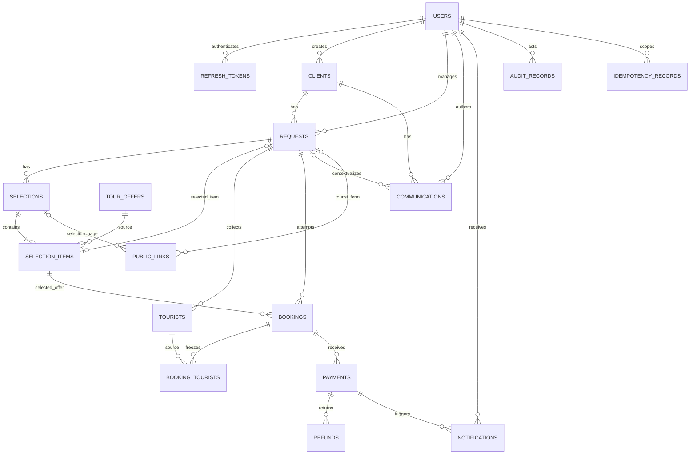

# Модель данных TravelCRM

Версия 0.2 от 15.11.2026. Базовая модель по #6 зафиксирована после проверки сценариев, схем и каркаса фронтенда по поручению владельца проекта. Результаты — в [проверке совместимости](api/frontend-review.md). Основание — [ТЗ 0.2](technical-specification.md). Реализация таблиц и миграций относится к #9 и последующим задачам.

Документ задаёт хранение, связи и ограничения. [Переходы статусов](state-transitions.md) задают поведение. [Контракт API](api/README.md), JSON Schema и OpenAPI фиксируют имена полей и операции. При расхождении со старыми продуктовыми схемами используется объём актуального ТЗ. Принятые уточнения перечислены в конце документа. Проверка выполнена по исходникам и сценариям; отдельное ревью коллеги и работающий сквозной интерфейс этим не заявляются.

## Общие соглашения

- Первичные ключи — UUID, в JSON строки. Внутренний последовательный `client_number` — отдельный уникальный номер клиента, не средство авторизации.
- Денежные значения — PostgreSQL `numeric(14,2)`, в JSON десятичные строки с двумя знаками, например `"125000.00"`. Расчёты выполняются через Decimal, без float. Единственная валюта — `RUB`.
- Моменты времени — `timestamptz`, передаются в RFC 3339 UTC с `Z`. Даты поездки и рождения — `date`, JSON `YYYY-MM-DD`. Отчёт за календарные дни Москвы использует интервал от начала первого дня включительно до начала следующего дня после последнего исключительно.
- `created_at`, `updated_at` и авторы операций устанавливаются сервером. Все изменяемые бизнес-карточки имеют целочисленный `version >= 1`; проверка ожидаемой версии и изменение выполняются атомарно. Конфликт версии возвращает `409`.
- Пустой контакт нормализуется в NULL. Телефон нормализуется в единый международный формат, email — trim и lower для поиска. Контакты не уникальны: родственники могут использовать один номер. Хотя бы один непустой контакт обязателен.
- Финансовые записи, брони и записи истории не удаляются физически. Удаление сотрудника заменяется `is_active = false`. FK бизнес-истории используют RESTRICT; каскадное удаление истории запрещено.
- Названия статусов и ролей в хранилище и JSON — значения из схемы. Русские подписи — только представление. Не создаётся общее поле «статус всей сделки».

## ER-диаграмма

Связь `REQUESTS.selected_selection_item_id` необязательна; один элемент может быть выбран только своей заявкой. У `PUBLIC_LINKS` ровно одна цель: заявка для формы туристов либо подборка для просмотра. `AUDIT_RECORDS` и `IDEMPOTENCY_RECORDS` содержат тип и идентификатор ресурса, поэтому все их связи на диаграмме не показаны.

## Учётные записи и клиенты

| Таблица | Основные поля | Ограничения |
|---|---|---|
| `users` | `id`, `full_name`, `email`, `password_hash`, `role`, `is_active`, даты | Уникальный нормализованный email; `role`: `manager`, `head`, `accountant`; хеш пароля никогда не входит в DTO |
| `refresh_tokens` | `id`, `user_id`, `token_hash`, `family_id`, `expires_at`, `revoked_at`, `replaced_by_id`, `created_at` | Уникальный хеш; хранится только хеш. Ротация и отзыв транзакционны; повторное использование заменённого токена отзывает семейство. Access после logout может жить до истечения своих 15 минут, refresh отозван сразу |
| `clients` | `id`, `client_number`, `created_by_id`, `full_name`, `full_name_normalized`, `phone`, `email`, `phone_normalized`, `email_normalized`, `preferences`, `note`, `version`, даты | `client_number` unique; CHECK контакта; имя непустое. Нормализованные контакты индексируются, но не unique; нормализованное имя используется только для поиска |
| `requests` | `id`, `client_id`, `manager_id`, `destination`, `starts_on`, `ends_on`, `tourist_count`, `budget`, `wishes`, `status`, `selected_selection_item_id`, `cancellation_reason`, `completed_at`, `cancelled_at`, `version`, даты | Ответственный — активный manager или head; туристов > 0; бюджет >= 0; окончание >= начала. Выбранный элемент принадлежит подборке этой заявки |

Менеджер видит заявку только при `manager_id = current_user.id`; руководитель — все; бухгалтер — финансовые представления. До первой заявки клиент доступен создавшему менеджеру; после появления заявок — менеджерам, ответственным хотя бы за одну его заявку, и руководителю. Доступ к клиенту не раскрывает чужие заявки, общение и туристов. После переназначения права пересчитываются по текущим ответственным.

Поиск дублей возвращает только доступные карточки. Совпадение с недоступной карточкой даёт `requires_head_review` и не раскрывает её контакты или UUID. При записи сервер повторно проверяет совпадения: доступные требуют `duplicate_acknowledged=true`, недоступные — проверки руководителем. Другой клиент с теми же контактами допускается после этой проверки; автоматического объединения и запрета создания однофамильцев нет.

В #12 реализованы clients, idempotency_records и базовая requests для прав доступа; #13 добавляет API заявок и audit_records. В #31 добавлены selected_selection_item_id, selections, selection_items и public_links (миграция 0006). Внутренний selection_items.request_id связывается составными FK с подборкой и выбранным элементом заявки; выбрать элемент чужой заявки запрещает сама БД. created_at подборки использует clock_timestamp(), чтобы порядок публикаций не зависел от времени начала ожидавшей блокировку транзакции. При редактировании клиента подтверждение дублей требуется только для новых нормализованных контактов. Изменение примечания или оформления того же телефона повторного подтверждения не требует. Проекции и порядок блокировок — в [подключении клиентов](api/clients-integration.md) и [заявок](api/requests-integration.md).

## Каталог, подборки и туристы

| Таблица | Основные поля | Ограничения |
|---|---|---|
| `tour_offers` | `id`, `title`, `destination`, `destination_normalized`, `starts_on`, `ends_on`, `tourist_count`, `supplier`, `services`, `price`, `currency`, `is_active`, `version`, даты | Реализовано в #30. Цена >= 0; число туристов > 0; даты корректны; currency=RUB; цена за всех туристов. services — одномерный text[] без NULL/пустых элементов; нормализованное направление используется только для поиска |
| `selections` | `id`, `request_id`, `created_by_id`, `created_at` | Создаётся атомарно с >= 1 элементом; после публикации состав и снимки неизменяемы. Повторный подбор создаёт новую подборку |
| `selection_items` | `id`, `selection_id`, `tour_offer_id`, `position`, `offer_snapshot` | UNIQUE `(selection_id, tour_offer_id)` и `(selection_id, position)`; `offer_snapshot` содержит заголовок, направление, даты, число туристов, поставщика, услуги, цену и валюту |
| `tourists` | `id`, `request_id`, `full_name`, `birth_date`, `document_type`, `document_number`, `document_expires_on`, `version`, даты | ФИО, дата рождения и номер документа обязательны; `document_type`: `passport` или `international_passport`; срок действия nullable, для загранпаспорта обязателен. Дата рождения не в будущем |
| `booking_tourists` | `id`, `booking_id`, `tourist_id`, `tourist_snapshot` | UNIQUE `(booking_id, tourist_id)`; копия данных туриста на момент подтверждения. Нельзя менять через последующее редактирование формы |
| `public_links` | `id`, `purpose`, `request_id`, `selection_id`, `token_hash`, `expires_at`, `revoked_at`, `created_by_id`, `created_at` | `purpose`: `selection` или `tourists`; CHECK ровно одной соответствующей цели; unique хеш; срок > создания |

Снимок — валидируемый JSONB по структуре `OfferSnapshot`/`TouristSnapshot`, а не произвольный JSON. Снимок предложения подборки не меняется при обновлении каталога. Бронь копирует выбранный снимок целиком. Если цена изменилась до подтверждения поставщиком, менеджер создаёт новую подборку и новую попытку брони; скрытого изменения цены существующей брони нет.

Форма туристов передаёт полный актуальный список одной атомарной операцией с ожидаемой версией заявки и ключом повтора. Переданный UUID туриста должен принадлежать этой заявке; новые записи получают UUID на сервере. Пустой список и несоответствие `tourist_count` отклоняются. Форма редактируется в in_progress/offer_prepared при отсутствии действующей брони; в остальных состояниях закрыта. Полный корректный список обязателен уже для создания pending-брони, иначе блокировка формы сделала бы подтверждение невозможным. При создании и подтверждении число туристов, число в снимке тура и число в заявке совпадают. Снимки туристов создаются в той же транзакции, что подтверждение брони; у pending/rejected-брони снимков может ещё не быть.

Публичный токен — 32 случайных байта, base64url без padding (43 символа); UUID ресурса его не заменяет. В БД только SHA-256-хеш; сырой токен выдаётся при создании/перевыпуске ссылки. Срок ссылки 7 дней, явный отзыв и перевыпуск с отзывом старой. Неверная, просроченная или отозванная ссылка даёт одинаковый 404. Токен не попадает в логи. Публичная подборка отдаёт только `PublicSelection`; форма туристов — пустой шаблон/число туристов, версию, редактируемость и результат приёма, без чтения паспортов ранее внесённых туристов. Публичные ответы — `Cache-Control: no-store`, `Referrer-Policy: no-referrer`, без внешних ресурсов на страницах. Выбор тура записывает сотрудник, кнопки самостоятельного бронирования нет.

`PublicLinkInfo` в карточке показывает только срок и активность. Для копирования используется url из ответа выдачи ссылки; после потери url выполняется явный перевыпуск. Команды выдачи не повторяются автоматически при неопределённом результате сети: повтор создал бы новый токен и отозвал предыдущий. Сырые url не сохраняются в идемпотентных ответах или истории.

## Брони и деньги

| Таблица | Основные поля | Ограничения |
|---|---|---|
| `bookings` | `id`, `request_id`, `selection_item_id`, `offer_snapshot`, `total_amount`, `currency`, `status`, `supplier_booking_number`, `rejection_reason`, `cancellation_reason`, `cancellation_response`, `confirmed_at`, `cancelled_at`, `version`, даты | `total_amount` равна цене снимка; >= 0; confirmed требует номера поставщика и снимков туристов; одна действующая бронь на заявку |
| `payments` | `id`, `booking_id`, `amount`, `currency`, `status`, `external_operation_id`, `provider`, `payment_url`, `failure_reason`, `succeeded_at`, даты | Сумма > 0; внешний номер unique в пределах провайдера; `pending`, `succeeded`, `failed`; ссылка — только на настроенный сервис заглушки |
| `refunds` | `id`, `payment_id`, `amount`, `currency`, `status`, `external_operation_id`, `provider`, `failure_reason`, `succeeded_at`, даты | Сумма > 0; возврат только успешного платежа отменённой брони; внешний номер unique в пределах провайдера; `processing`, `succeeded`, `failed` |

Действующие статусы брони: `pending_confirmation`, `confirmed`, `cancellation_requested`. Частичный unique индекс по `bookings(request_id)` с этим предикатом запрещает две действующие брони. Отклонённые и отменённые попытки сохраняются.

Под блокировкой строки брони рассчитываются:

- `paid_amount = SUM(payments.amount WHERE status = succeeded)`;
- `reserved_payment_amount = SUM(payments.amount WHERE status = pending)`;
- `remaining_amount = total_amount - paid_amount` — остаток долга для интерфейса;
- `available_payment_amount = total_amount - paid_amount - reserved_payment_amount` — максимум нового платежа;
- `refunded_amount = SUM(refunds.amount WHERE status = succeeded)` по платежам этой брони.

Под блокировкой брони, затем исходного платежа, максимум нового возврата: успешная сумма исходного платежа минус его `succeeded` и `processing` возвраты. Порядок блокировок одинаков во всех операциях. Суммы нескольких строк не защищаются одним CHECK: нужны транзакции, блокировки и интеграционные тесты с параллельными запросами.

Ожидающие операции резервируют остаток. Тайм-аут не освобождает резерв и не означает ошибку: адаптер сверяет состояние по внешнему идентификатору. Новая попытка после подтверждённой ошибки имеет новый идентификатор. При отмене нельзя создать новый платёж; до завершения отмены все pending-платежи должны быть сверены и переведены в конечное состояние. Успешные деньги не обнуляются при отмене и не переносятся на новую бронь. Возврат не увеличивает допустимую сумму новых платежей старой брони.

Вызов внешнего HTTP-сервиса не удерживает транзакционную блокировку. Сначала фиксируются локальная операция и резерв, затем выполняется HTTP-запрос с постоянным ключом операции, затем в отдельной транзакции сохраняется ответ. После сбоя процесс повторяет запрос с тем же ключом или сверяет состояние. Заглушка обязана поддерживать такое восстановление. Результат принимается только от адаптера/проверенного отправителя, с совпадающими номером, валютой и суммой; переход браузера на страницу успеха не подтверждает оплату.

## История и повторы

| Таблица | Основные поля | Ограничения |
|---|---|---|
| `communications` | `id`, `client_id`, `request_id` nullable, `author_id`, `channel`, `text`, `occurred_at`, `created_at` | Реализовано в #16. Составной FK `(request_id, client_id)` на уникальную пару `requests(id, client_id)` гарантирует принадлежность заявки клиенту; отдельные FK клиента и автора — RESTRICT. Канал `phone`, `email`, `messenger`, `office`, `other`; текст непустой. `occurred_at` — время контакта, `created_at` — серверное время записи |
| `notifications` | `id`, `recipient_id`, `payment_id`, `type`, `read_at`, `created_at` | Тип `payment_succeeded`; UNIQUE `(recipient_id, payment_id, type)`. По одному уведомлению каждому получателю; читается только своё |
| `audit_records` | `id`, `request_id`, `actor_id` nullable, `source`, `entity_type`, `entity_id`, `action`, `changes`, `created_at` | `source`: `staff`, `payment_service`, `system`; неизменяемые записи. changes — массив белого списка field/old_value/new_value, как в AuditChange; request_id индексируется с created_at. Автор nullable только для сервиса/системы; без паролей, токенов и паспортов в JSON |
| `idempotency_records` | `id`, `actor_scope`, `operation`, `key`, `request_hash`, `resource_type`, `resource_id`, `result_metadata`, `created_at` | UNIQUE `(actor_scope, operation, key)`; операция включает HTTP-метод и путь; другой body — 409; тот же — исходный ресурс. result_metadata хранит только безопасный результат формы (счётчик/версия), без паспортов и токенов |

Точный перечень команд с обязательным `Idempotency-Key` указан в OpenAPI; он включает создание клиента, заявки, подборки, брони, платежа, возврата, записи общения и редактирование карточек/туристов. Область — сотрудник либо конкретная публичная ссылка. Одновременные запросы с одним ключом сериализуются уникальностью записи в одной транзакции с бизнес-операцией. Сначала проверяется текущий доступ/активность ссылки, затем повтор, затем ожидаемая версия. Повтор возвращает тот же ресурс в текущем разрешённом представлении; для публичной формы — сохранённые accepted_count/request_version исходной отправки. Внешние результаты дополнительно защищены уникальным номером провайдера. Срок хранения ключей не короче жизни соответствующей операции в учебном MVP.

Запись аудита создаётся транзакционно со сменой ответственного, статуса брони, денежного статуса и результатом возврата. Успешный результат платежа, финансовая сумма, аудит и уведомления фиксируются одной транзакцией. Получатели — текущий ответственный и активные руководители, с устранением повторов. Уведомление не даёт права читать заявку после её переназначения.

Записи общения без заявки доступны руководителю и менеджерам с доступом к клиенту. Записи с заявкой — только её текущему ответственному и руководителю. Бухгалтер не получает контакты, общение и паспортные данные: финансовый DTO содержит идентификаторы и суммы, а не вложенную полную карточку клиента.

## Индексы

Помимо PK и индексов UNIQUE:

- `requests(manager_id, status, created_at)`, `requests(client_id)`, `requests(created_at)`;
- `clients(phone_normalized)`, `clients(email_normalized)`, `clients(created_by_id)`; поиск по части имени через `pg_trgm` и GIN по нормализованному имени;
- Для активного `tour_offers`: частичный индекс `(tourist_count, starts_on, price)` и GIN/pg_trgm по `destination_normalized` для поиска подстроки; окончательный состав уточняется по EXPLAIN;
- `selections(request_id, created_at)`, `selection_items(selection_id, position)`, `tourists(request_id)`;
- `bookings(request_id, created_at)`, частичный unique действующей брони, индекс по `confirmed_at`;
- `payments(booking_id, status)`, `payments(succeeded_at)` WHERE succeeded; аналогично для `refunds(payment_id, status)` и `refunds(succeeded_at)`;
- `communications(client_id, occurred_at, id)`, `communications(request_id, occurred_at, id)` для стабильного порядка ленты;
- `notifications(recipient_id, created_at)` WHERE read_at IS NULL;
- `audit_records(entity_type, entity_id, created_at)`, `refresh_tokens(user_id, family_id)` и индексы внешних ключей, не покрытых перечисленными индексами.

Отчёт считает подтверждения по сохранённому `confirmed_at`, включая впоследствии отменённые брони; отмена не стирает исторический факт подтверждения. Оплаты и возвраты показываются отдельно по `succeeded_at`, без неявного вычитания возвратов из строки оплат.

## Зафиксированные уточнения и представления API

Приняты по результатам сверки: доступ к клиенту до первой заявки; срок ссылок 7 дней и явный перевыпуск; поля документов туристов; полный список до создания брони и закрытие формы при действующей брони; резерв pending-сумм; сверка pending-платежей до завершения отмены; отдельный статус оплаченной отмены с возможностью возобновить заявку после завершения ожидающих операций; деньги строками.

Read DTO дополнены серверными проекциями для экранов: `Request.client`, `manager`, `selected_offer`, `selected_selection_id`, `active_booking`, `tourists_received`, `tourist_form_editable`, `tourist_link`; `Booking.tourists`; `Payment` с итогами и доступным остатком возврата; `FinancialBooking` для бухгалтера; `Communication.author`; разрешённые действия `allowed_actions`. Эти поля не являются новыми колонками с дублирующими данными и не принимаются в командах записи. Они вычисляются с проверкой прав. Списки имеют пагинацию и стабильную сортировку; доступ фильтруется до подсчёта total.

Изменение списка туристов, подборки, выбора или статуса заявки увеличивает её version. Изменение статуса брони и финансовых итогов увеличивает version брони. Смена состояния дочерней сущности может изменить проекцию родителя: интерфейс перечитывает затронутые карточки и не вычисляет следующую версию самостоятельно. `allowed_actions` — текущая подсказка для кнопок, а не замена серверной проверки.
