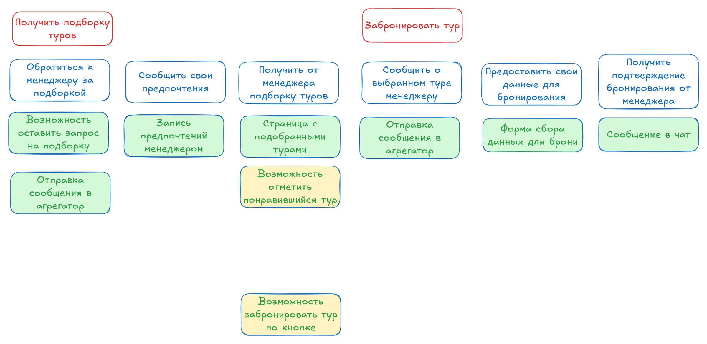
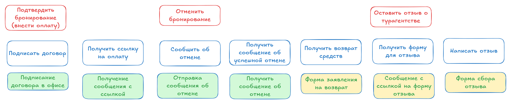
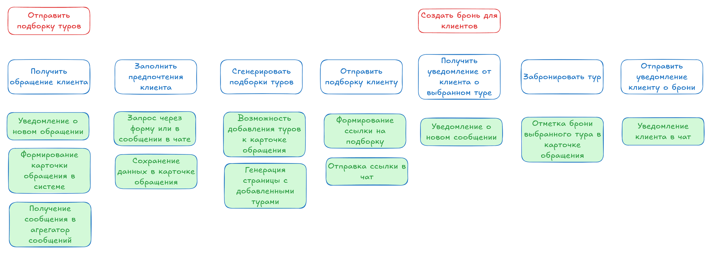
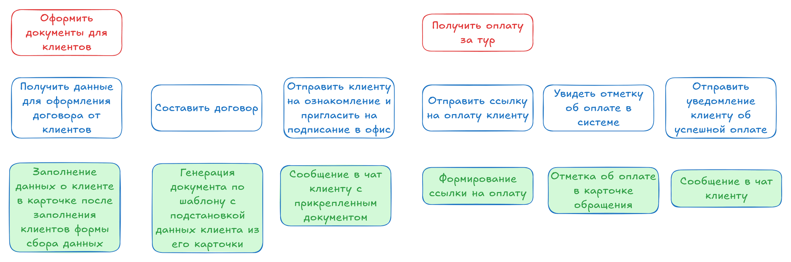
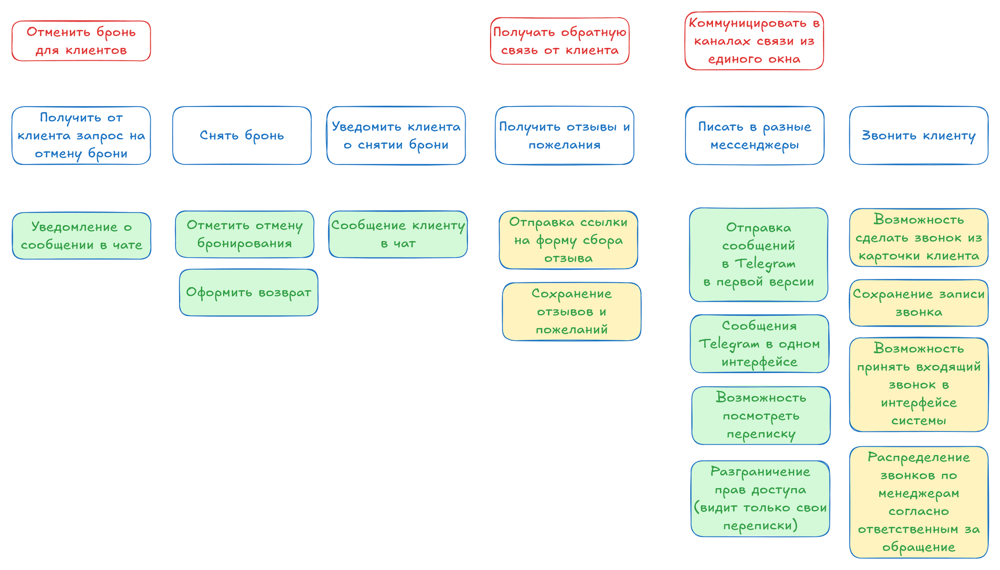
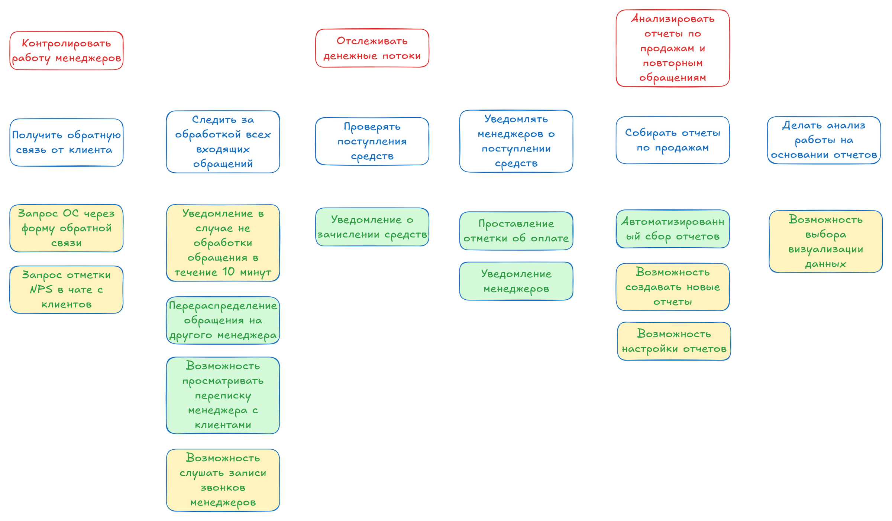

# Карта пользовательских историй

Источник: Практика 2.

## 1. Общие сведения

TravelCRM предназначена для туристической компании «ТрэвелМастер». Система объединяет клиентов, обращения, бронирования и оплаты. Карта показывает, какие функции нужны для первой рабочей версии и что будет добавлено после неё.

| Параметр | Значение |
|---|---|
| Заказчик | Туристическая компания «ТрэвелМастер»; куратор — руководитель отдела продаж |
| Сроки и бюджет проекта | 13.09.2026–13.02.2027; 1 750 000 рублей |
| Основные пользователи | Клиент, менеджер и руководитель отдела продаж; бухгалтер участвует в оплатах и возвратах |
| Цель первой версии | Провести обращение от подбора тура до брони и учёта оплаты, сохранив все данные в CRM |

## 2. Карта пользовательских историй

Карта состоит из двух слоёв. Первый слой содержит цели пользователей и шаги для их достижения. Второй слой содержит функции MVP и версии 2. На картинках цели красные, шаги синие; у функций зелёная заливка означает MVP, жёлтая — следующую версию. Коды M01–M12 в [разделе 3](#3-задачи-mvp) обозначают задачи первой версии.

В MVP (по исходным практикам) клиент общается через Telegram и получает ссылки на подборку, форму и оплату. Отдельный личный кабинет не требуется. Менеджер работает в веб-интерфейсе CRM.

> **Объём нашей реализации.** Telegram и договор в нашу версию MVP не входят, см. [README](README.md#объём-mvp-в-нашей-реализации). Ниже карта приведена как в практике; отметки «MVP» и «v2» относятся к исходному документу. Что мы делаем фактически, показывает [сводка сценариев](user-scenarios.md).

Условные обозначения в таблицах: **MVP** — зелёная заливка, **v2** — жёлтая заливка.

### 2.1. Клиент — подбор и бронирование

| Цель | Шаг | Функции |
|---|---|---|
| Получить подборку туров | Обратиться к менеджеру за подборкой | MVP: возможность оставить запрос на подборку; отправка сообщения в агрегатор |
| | Сообщить свои предпочтения | MVP: запись предпочтений менеджером |
| | Получить от менеджера подборку туров | MVP: страница с подобранными турами v2: возможность отметить понравившийся тур v2: возможность забронировать тур по кнопке |
| Забронировать тур | Сообщить о выбранном туре менеджеру | MVP: отправка сообщения в агрегатор |
| | Предоставить свои данные для бронирования | MVP: форма сбора данных для брони |
| | Получить подтверждение бронирования от менеджера | MVP: сообщение в чат |

### 2.2. Клиент — оплата, отмена и отзыв

| Цель | Шаг | Функции |
|---|---|---|
| Подтвердить бронирование (внести оплату) | Подписать договор | MVP: подписание договора в офисе |
| | Получить ссылку на оплату | MVP: получение сообщения со ссылкой |
| Отменить бронирование | Сообщить об отмене | MVP: отправка сообщения об отмене |
| | Получить сообщение об успешной отмене | MVP: получить сообщение об отмене |
| | Получить возврат средств | v2: форма заявления на возврат |
| Оставить отзыв о турагентстве | Получить форму для отзыва | v2: сообщение со ссылкой на форму отзыва |
| | Написать отзыв | v2: форма сбора отзыва |

### 2.3. Менеджер — подбор и бронирование

| Цель | Шаг | Функции |
|---|---|---|
| Отправить подборку туров | Получить обращение клиента | MVP: уведомление о новом обращении MVP: формирование карточки обращения в системе MVP: получение сообщения в агрегатор сообщений |
| | Заполнить предпочтения клиента | MVP: запрос через форму или в сообщении в чате MVP: сохранение данных в карточке обращения |
| | Сгенерировать подборки туров | MVP: возможность добавления туров к карточке обращения MVP: генерация страницы с добавленными турами |
| | Отправить подборку клиенту | MVP: формирование ссылки на подборку MVP: отправка ссылки в чат |
| Создать бронь для клиентов | Получить уведомление от клиента о выбранном туре | MVP: уведомление о новом сообщении |
| | Забронировать тур | MVP: отметка брони выбранного тура в карточке обращения |
| | Отправить уведомление клиенту о брони | MVP: уведомление клиента в чат |

### 2.4. Менеджер — документы и оплата

| Цель | Шаг | Функции |
|---|---|---|
| Оформить документы для клиентов | Получить данные для оформления договора от клиентов | MVP: заполнение данных о клиенте в карточке после заполнения клиентом формы сбора данных |
| | Составить договор | MVP: генерация документа по шаблону с подстановкой данных клиента из его карточки |
| | Отправить клиенту на ознакомление и пригласить на подписание в офис | MVP: сообщение в чат клиенту с прикреплённым документом |
| Получить оплату за тур | Отправить ссылку на оплату клиенту | MVP: формирование ссылки на оплату |
| | Увидеть отметку об оплате в системе | MVP: отметка об оплате в карточке обращения |
| | Отправить уведомление клиенту об успешной оплате | MVP: сообщение в чат клиенту |

### 2.5. Менеджер — отмена, отзывы и связь

| Цель | Шаг | Функции |
|---|---|---|
| Отменить бронь для клиентов | Получить от клиента запрос на отмену брони | MVP: уведомление о сообщении в чате |
| | Снять бронь | MVP: отметить отмену бронирования MVP: оформить возврат |
| | Уведомить клиента о снятии брони | MVP: сообщение клиенту в чат |
| Получать обратную связь от клиента | Получить отзывы и пожелания | v2: отправка ссылки на форму сбора отзыва v2: сохранение отзывов и пожеланий |
| Коммуницировать в каналах связи из единого окна | Писать в разные мессенджеры | MVP: отправка сообщений в Telegram в первой версии MVP: сообщения Telegram в одном интерфейсе MVP: возможность посмотреть переписку MVP: разграничение прав доступа (видит только свои переписки) |
| | Звонить клиенту | v2: возможность сделать звонок из карточки клиента v2: сохранение записи звонка v2: возможность принять входящий звонок в интерфейсе системы v2: распределение звонков по менеджерам согласно ответственным за обращение |

### 2.6. Руководитель отдела продаж

| Цель | Шаг | Функции |
|---|---|---|
| Контролировать работу менеджеров | Получить обратную связь от клиента | v2: запрос обратной связи через форму v2: запрос отметки NPS в чате с клиентов |
| | Следить за обработкой всех входящих обращений | v2: уведомление в случае не обработки обращения в течение 10 минут MVP: перераспределение обращения на другого менеджера MVP: возможность просматривать переписку менеджера с клиентами v2: возможность слушать записи звонков менеджеров |
| Отслеживать денежные потоки | Проверять поступления средств | MVP: уведомление о зачислении средств |
| | Уведомлять менеджеров о поступлении средств | MVP: проставление отметки об оплате MVP: уведомление менеджеров |
| Анализировать отчёты по продажам и повторным обращениям | Собирать отчёты по продажам | MVP: автоматизированный сбор отчётов v2: возможность создавать новые отчёты v2: возможность настройки отчётов |
| | Делать анализ работы на основании отчётов | v2: возможность выбора визуализации данных |

## 3. Задачи MVP

В первую версию входят следующие задачи. Авторизация, права доступа, проверка данных и резервное копирование нужны для всех задач MVP.

| Код | Задача | Что будет реализовано | В нашей версии |
|---|---|---|---|
| M01 | Обращения и клиенты | Принять сообщение Telegram, найти или создать клиента, создать заявку, сохранить переписку и ответить из CRM. | Частично: без Telegram; заявку и клиента создаёт менеджер, переписка — записи общения |
| M02 | Предпочтения | Записать направление, даты, бюджет, число туристов и пожелания. | Да |
| M03 | Подборка туров | Выбрать туры из базы, создать страницу подборки, отправить ссылку и записать выбор клиента. | Да; ссылку менеджер копирует и отправляет сам |
| M04 | Данные туристов | Собрать данные через форму и проверить обязательные поля. | Да |
| M05 | Бронирование | Сохранить запрос, номер брони и ответ туроператора; отправить подтверждение клиенту. | Да; ответ поставщика вносит менеджер |
| M06 | Договор | Сформировать договор по шаблону, отправить файл, сохранить скан и отметку о подписании в офисе. | Нет, отложено |
| M07 | Ссылка на оплату | Создать платёж через один сервис и передать ссылку клиенту. | Да; сервис — заглушка |
| M08 | Учёт оплаты | Получить подтверждение сервиса, один раз учесть платёж и уведомить менеджера. | Да |
| M09 | Отмена | Записать просьбу клиента, получить подтверждение поставщика, сменить статус и уведомить клиента. | Да |
| M10 | Возврат | Сохранить согласованную сумму, отправить возврат в сервис и учесть его результат. | Да |
| M11 | Контроль заявок | Показать руководителю заявки, оплаты и переписки; разрешить смену ответственного. | Да |
| M12 | Простой отчёт | Показать за период количество заявок и броней, суммы успешных оплат и возвратов. | Да |

MVP готова, когда менеджер может пройти основной сценарий от нового обращения до учтённой оплаты, а также обработать отмену и возврат. Руководитель должен видеть результат в списке заявок и простом отчёте.

## 4. Инварианты

Инварианты — это правила, которые должны выполняться при любой работе с системой.

| Область | Правило |
|---|---|
| Клиенты и заявки | У клиента есть уникальный номер. Перед созданием карточки выполняется поиск по контактам. Совпадение контактов требует проверки, а не автоматического слияния. Каждая заявка связана с клиентом и ответственным менеджером. |
| Сообщения | Повторная доставка одного и того же сообщения не создаёт вторую заявку. Новое обращение существующего клиента может стать отдельной заявкой. |
| Бронирование | Для подтверждения нужны выбранный тур, данные туристов, стоимость и подтверждение поставщика. Отправка запроса ещё не означает подтверждённую бронь. |
| Договор | Документ относится к конкретным клиенту и брони. После подписания сохраняется его версия. Сообщение «согласен» в чате не заменяет принятую для MVP процедуру подписания в офисе. |
| Оплата | Оплата учитывается только по подтверждённому результату сервиса. Один внешний номер платежа учитывается один раз. Статусы бронирования и оплаты хранятся отдельно. |
| Возврат | Сумма положительная и не превышает полученную оплату за вычетом предыдущих возвратов. Отмена брони сама по себе не означает, что деньги уже возвращены. |
| Доступ | Менеджер видит закреплённые за ним заявки. Руководитель видит все заявки. Бухгалтер получает доступ к оплатам и возвратам. Изменение ответственного и денежных статусов записывается в историю. |

## 5. Особенности разработки

Для MVP подключаются Telegram и один платёжный сервис. Бронирование у туроператора менеджер выполняет привычным способом, затем сохраняет подтверждение в CRM. При сбое внешнего сервиса заявка остаётся в ожидании, а сотрудник видит причину ошибки.

Нужны тестовые доступы к внешним сервисам, шаблон договора и пример выгрузки клиентов. Импорт выполняется с проверкой дублей. Паспортные данные видят только сотрудники, которым они нужны; данные банковских карт в CRM не хранятся. Перед запуском проверяется восстановление из резервной копии.

## 6. Развитие после MVP

Версия 2 завершает функции, предусмотренные матрицей проекта: подключение трёх каналов связи, рекомендации и более полный учёт платежей. Деление на версии задаёт очерёдность реализации в рамках общего проекта.

| Направление | Функции версии 2 |
|---|---|
| Коммуникации | Email и телефония в едином окне, входящие и исходящие звонки, запись разговоров и распределение звонков по ответственным менеджерам. |
| Подбор и бронирование | Рекомендации по предпочтениям и истории поездок, избранное, выбор тура кнопкой, повторное использование данных туристов и интеграция с API туроператора. |
| Платежи и отмена | Дополнительные способы оплаты, обмен с 1С и банковскими данными, запрос отмены через API и форма заявления на возврат. |
| Отзывы и контроль | Форма отзыва после поездки, оценка готовности рекомендовать компанию, уведомление о заявке без ответа в течение 10 минут, отчёты по повторным обращениям и настраиваемые графики. |
