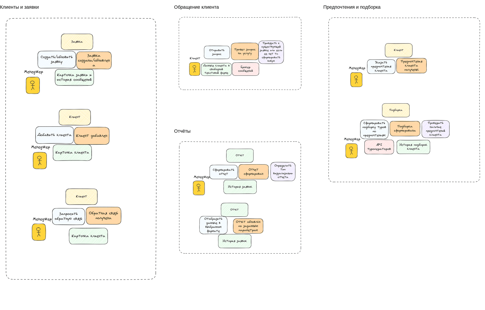
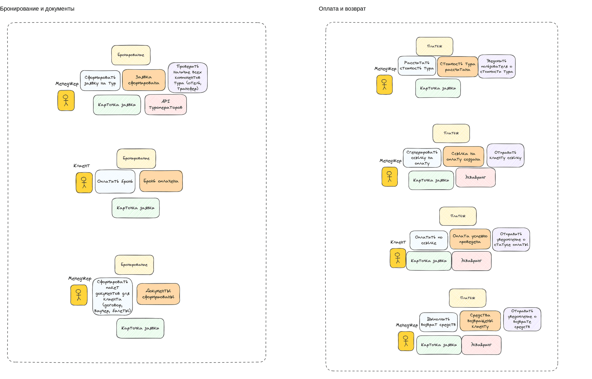
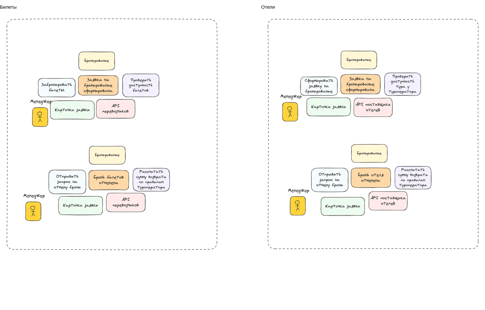

# Карта событий TravelCRM (Event Storming)

Источник: Практика 3.

## 1. Описание процесса

TravelCRM автоматизирует работу туристической компании «ТрэвелМастер». Рассматривается процесс от обращения клиента до бронирования, оплаты и завершения поездки. Отдельно показаны отмена, возврат, обратная связь и контроль продаж.

Параметры проекта: 13.09.2026–13.02.2027, бюджет 1 750 000 рублей. Основные участники: клиент, менеджер, руководитель отдела продаж и бухгалтер. IT-отдел заказчика помогает с доступами и запуском системы.

## 2. Обозначения на карте

| Элемент | Цвет | Пример и смысл |
|---|---|---|
| Персонаж | Жёлтая фигура | Менеджер — участник, выполняющий действие. |
| Команда | Голубой | «Сформировать договор» — действие, которое требуется выполнить. |
| Событие | Оранжевый | «Договор сформирован» — уже произошедший факт. |
| Политика | Фиолетовый | «Отправить клиенту ссылку» — правило после создания ссылки на оплату. |
| Агрегат | Жёлтый | «Бронирование» — данные и правила, к которым относится команда. |
| Внешняя система | Розовый | Telegram, туроператор, платёжный сервис. |
| Модель чтения | Зелёный | Карточка, пакет документов или отчёт для просмотра. |
| Граница области | Серый пунктир | Объединяет связанные сценарии исходной карты. |

В MVP данные о бронировании и отмене вносит менеджер после ответа поставщика. В версии 2 этот обмен можно выполнять через API. Подборка в MVP создаётся менеджером, а автоматические рекомендации и форма отзыва относятся к версии 2.

## 3. Карта событий

Ниже каждая карта дана картинкой и расшифрована таблицей: персонаж выполняет **команду** над **агрегатом**, происходит **событие**, затем срабатывает **политика**; используются **внешняя система** и **модель чтения**.

### 3.1. Клиенты и заявки, обращение, подборка, отчёты

| Область | Агрегат | Персонаж | Команда | Событие | Политика | Внешняя система | Модель чтения |
|---|---|---|---|---|---|---|---|
| Клиенты и заявки | Заявка | Менеджер | Создать или обновить заявку | Заявка создана или обновлена | | | Карточка заявки и история сообщений |
| Клиенты и заявки | Клиент | Менеджер | Добавить клиента | Клиент добавлен | | | Карточка клиента |
| Клиенты и заявки | Клиент | Менеджер | Запросить обратную связь | Обратная связь получена | | | Карточка клиента |
| Обращение клиента | | Клиент | Отправить запрос | Пришёл запрос на услугу | Привязать к существующей заявке или, если её нет, сформировать новую | Брокер сообщений | Данные клиента в свободной текстовой форме |
| Предпочтения и подборка | Клиент | Менеджер | Указать предпочтения клиента | Предпочтения клиента получены | | | |
| Предпочтения и подборка | Подборка | Менеджер | Сформировать подборку туров по предпочтениям | Подборка сформирована | Проверить наличие предпочтений клиента | API туроператоров | История подборок клиента |
| Отчёты | Отчёт | Менеджер | Сформировать отчёт | Отчёт сформирован | Определить тип визуализации отчёта | | История заявок |
| Отчёты | Отчёт | Менеджер | Отобразить данные в выбранном формате | Отчёт обновлён по заданным параметрам | | | История заявок |

### 3.2. Бронирование и документы, оплата и возврат

| Область | Агрегат | Персонаж | Команда | Событие | Политика | Внешняя система | Модель чтения |
|---|---|---|---|---|---|---|---|
| Бронирование и документы | Бронирование | Менеджер | Сформировать заявку на тур | Заявка сформирована | Проверить наличие всех компонентов тура (отель, трансфер) | API туроператоров | Карточка заявки |
| Бронирование и документы | Бронирование | Клиент | Оплатить бронь | Бронь оплачена | | | Карточка заявки |
| Бронирование и документы | Бронирование | Менеджер | Сформировать пакет документов для клиента (договор, ваучер, билеты) | Документы сформированы | | | Карточка заявки |
| Оплата и возврат | Платёж | Менеджер | Рассчитать стоимость тура | Стоимость тура рассчитана | Уведомить пользователя о стоимости тура | | Карточка заявки |
| Оплата и возврат | Платёж | Менеджер | Сгенерировать ссылку на оплату | Ссылка на оплату создана | Отправить клиенту ссылку | Эквайринг | Карточка заявки |
| Оплата и возврат | Платёж | Клиент | Оплатить по ссылке | Оплата успешно проведена | Отправить уведомление о статусе оплаты | Эквайринг | Карточка заявки |
| Оплата и возврат | Платёж | Менеджер | Выполнить возврат средств | Средства возвращены клиенту | Отправить уведомление о возврате средств | Эквайринг | Карточка заявки |

### 3.3. Билеты и отели (после MVP)

| Область | Агрегат | Персонаж | Команда | Событие | Политика | Внешняя система | Модель чтения |
|---|---|---|---|---|---|---|---|
| Билеты | Бронирование | Менеджер | Забронировать билеты | Заявка на бронирование сформирована | Проверить доступность билетов | API перевозчиков | Карточка заявки |
| Билеты | Бронирование | Менеджер | Отправить запрос на отмену брони | Бронь билетов отменена | Рассчитать сумму возврата по правилам туроператора | API перевозчиков | Карточка заявки |
| Отели | Бронирование | Менеджер | Сформировать заявку на бронирование | Заявка на бронирование сформирована | Проверить доступность тура у туроператора | API поставщика отелей | Карточка заявки |
| Отели | Бронирование | Менеджер | Отправить запрос на отмену брони | Бронь отеля отменена | Рассчитать сумму возврата по правилам туроператора | API поставщика отелей | Карточка заявки |

Сценарии отдельных перевозчиков и отелей оставлены из исходной карты для развития после MVP. В первой версии менеджер работает через туроператора.

## 4. Словарь проекта

Термины используются одинаково в карте, интерфейсе и описании проекта. Заявка, бронирование и платёж — разные объекты: одна заявка не становится оплаченной только из-за подтверждения брони.

| Термин | Определение |
|---|---|
| TravelCRM | CRM-система туристической компании «ТрэвелМастер». |
| Клиент | Человек, который обращается за подбором и покупкой тура. Заказчик может передавать данные нескольких туристов. |
| Турист | Участник поездки, данные которого нужны для бронирования и документов. |
| Менеджер | Сотрудник, который ведёт заявку: уточняет пожелания, подбирает тур, оформляет бронь и общается с клиентом. |
| РОП | Руководитель отдела продаж. Контролирует заявки, менеджеров и показатели продаж. |
| Заявка или обращение | Запись о конкретном запросе клиента. Содержит пожелания, ответственного и текущее состояние обработки. |
| Тур | Предложение туристических услуг с направлением, датами, составом услуг и ценой. |
| Подборка | Набор туров, выбранных для конкретной заявки и отправленных клиенту. |
| Бронирование | Запись о резервировании выбранного тура у поставщика. Содержит туристов, стоимость, внешний номер, документы и статус. |
| Туроператор или поставщик | Внешняя организация, которая подтверждает доступность тура, бронирование и отмену. |
| Платёж | Операция оплаты, связанная с бронью. В CRM хранятся сумма, внешний номер и результат операции. |
| Эквайринг | Внешний сервис, через который клиент оплачивает тур и выполняется возврат. |
| Возврат | Операция возврата согласованной суммы по ранее полученному платежу. |
| Диалог | История сообщений с клиентом по заявке. В MVP используется Telegram, затем добавляются другие каналы. |
| Агрегат | Группа связанных данных и правил, которая изменяется через один основной объект. |
| Домен | Область работы системы со своими данными и правилами, например бронирование или расчёты. |

## 5. Агрегаты

Выделено семь агрегатов. Карта показывает основные бизнес-сценарии; каталог туров и хранение диалогов дополнены в таблице. Объекты связываются по номеру: например, платёж хранит номер бронирования.

| Агрегат | Что содержит | Основное правило |
|---|---|---|
| Клиент | Контакты, предпочтения, сведения о туристах и отзывы | Перед созданием проверить существующую карточку. |
| Заявка | Клиент, пожелания, ответственный, состояние обработки | Есть клиент и ответственный; повторное сообщение не создаёт дубль. |
| Тур | Направление, даты, поставщик, состав услуг и текущая цена | Цена неотрицательная, дата окончания не раньше начала. |
| Подборка | Ссылка на заявку и список вариантов туров | Для отправки нужен хотя бы один вариант; есть связь с заявкой. |
| Бронирование | Выбранный тур, туристы, согласованная цена, номер поставщика, статусы и документы | Подтверждение и отмена фиксируются только после ответа поставщика. |
| Платёж | Номер операции, бронь, сумма, статус и операции возврата | Повторный ответ не удваивает сумму; возврат ограничен остатком оплаты. |
| Диалог | Заявка, канал и сообщения с внешними номерами | Сообщение связано с заявкой и сохраняется один раз. |

Отели, билеты и трансфер рассматриваются как состав тура и услуги внешних поставщиков. В MVP они не выделяются в самостоятельные агрегаты CRM. Договор входит в бронирование, операции возврата — в платёж. Отчёт строится по накопленным данным и отдельным агрегатом не является.

## 6. Домены на основе агрегатов

| Домен | Агрегаты | Ответственность |
|---|---|---|
| Клиенты и заявки | Клиент, Заявка | Карточки клиентов, предпочтения и обработка обращений. |
| Подбор туров | Тур, Подборка | Каталог предложений, подбор и рекомендации. |
| Бронирование | Бронирование | Резервирование, подтверждение, отмена и документы. |
| Расчёты | Платёж | Оплата, проверка результатов и возвраты. |
| Коммуникации | Диалог | Переписка и подключение каналов связи. |

## 7. Распределение работы по командам

Для проекта достаточно основной команды разработки и небольшой внешней команды интеграций. Деление проводится по ответственности за функции, без создания отдельной команды на каждый агрегат.

| Исполнитель | Зона ответственности |
|---|---|
| Основная команда проекта | Домены «Клиенты и заявки», «Подбор туров» и «Бронирование». Интерфейс CRM, база данных, простые отчёты и общая проверка работы системы. |
| Основная команда по расчётам | Правила домена «Расчёты»: суммы, статусы, защита от повторного учёта и ограничения возвратов. Это часть основной команды, а не отдельное подразделение. |
| Внешняя команда интеграций | Домен «Коммуникации»: Telegram в MVP, email и телефония в версии 2. Также подключение эквайринга, а позднее API туроператора и обмен с 1С. Правила расчётов остаются у основной команды. |
| IT-отдел заказчика | Тестовые доступы, сервер, резервное копирование и помощь при запуске. Руководитель отдела продаж и бухгалтер проверяют свои сценарии. |

Основная команда задаёт форматы обмена: номер клиента, заявки, брони и платежа, сумму и статус операции. Внешняя команда передаёт код и краткую инструкцию по настройке. Интеграции сначала проверяются на тестовых данных.

> В нашей учебной реализации оба участника входят в основную команду, а внешние сервисы заменены заглушками. Распределение работ между участниками ведётся в [Issues](https://github.com/d1vide/travel-crm/issues).

## 8. Базовое решение об архитектуре

Для TravelCRM выбирается модульный монолит: одно серверное приложение с модулями по выделенным доменам и общей базой данных. Сотрудники работают в браузере. Telegram, эквайринг и сервисы поставщиков подключаются через отдельные части программы для обмена данными.

Такой вариант подходит для проекта со сроком около пяти месяцев и бюджетом 1 750 000 рублей. Одно приложение проще разворачивать, проверять и сопровождать небольшой команде. Микросервисы потребовали бы отдельных развёртываний и дополнительной настройки обмена между сервисами, хотя для первой версии такой необходимости нет.

Границы модулей сохраняются внутри монолита. Модуль платежей передаёт результат в бронирование и отчёты; коммуникации хранят сообщения, связанные с заявкой. При дальнейшем росте нагрузки модуль коммуникаций можно выделить отдельно.

### Схема доменов и архитектуры

~~~mermaid
flowchart TB
    subgraph Domains["Домены и агрегаты"]
        D1["Клиенты и заявки Клиент, Заявка"]
        D2["Подбор туров Тур, Подборка"]
        D3["Бронирование Бронирование"]
        D4["Расчёты Платёж"]
        D5["Коммуникации Диалог"]
    end

    Staff["Сотрудники в браузере"] --> App["Одно приложение TravelCRM 5 модулей по доменам и простые отчёты"]
    App --> DB[("Общая база данных")]
    App --> Ext["Внешние системы Telegram, эквайринг; в версии 2 — email, телефония, API туроператора и 1С"]
~~~

Основная команда отвечает за клиентов, подбор, бронирование, расчёты и отчёты. Аутсорс: коммуникации и подключение платёжного сервиса под контролем основной команды.

## 9. Уточнения и особые случаи

| Ситуация | Решение |
|---|---|
| Поставщик отказал в бронировании | Сохранить отказ. Менеджер предлагает другой тур; бронь не получает статус «Подтверждена». |
| Не пришёл ответ об оплате | Оставить ожидание и запросить статус в сервисе. Повторное уведомление по тому же номеру учитывается один раз. |
| Бронь отменена, возврат ещё идёт | Отдельно хранить статус отмены и статус возврата. Сообщать об успешном возврате только после подтверждения сервиса. |
| Внешний канал недоступен | Сохранить данные заявки и показать ошибку сотруднику. После восстановления повторить отправку без дублирования операции. |
